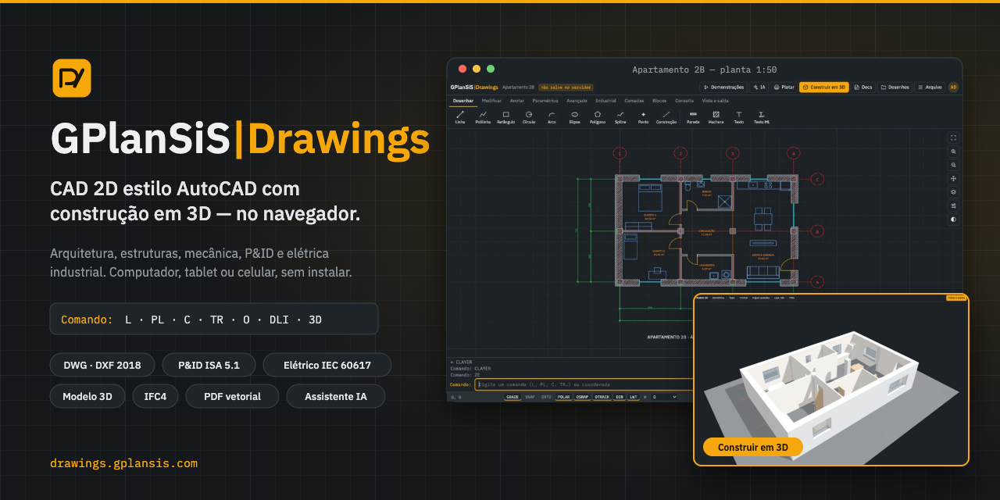
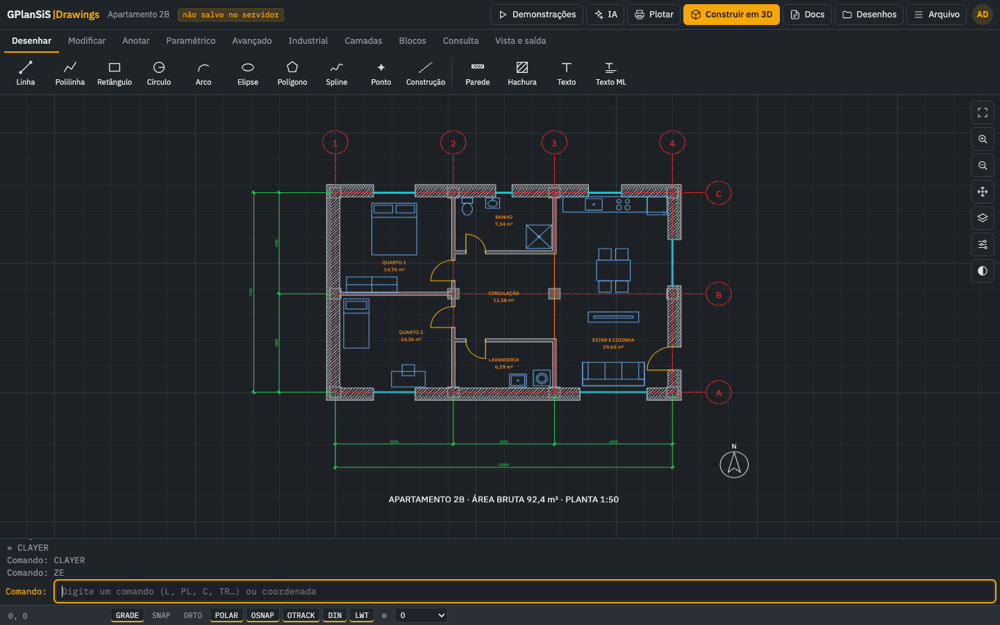
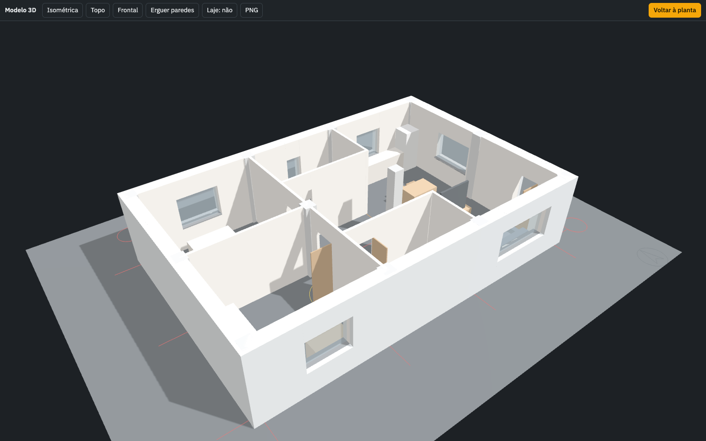
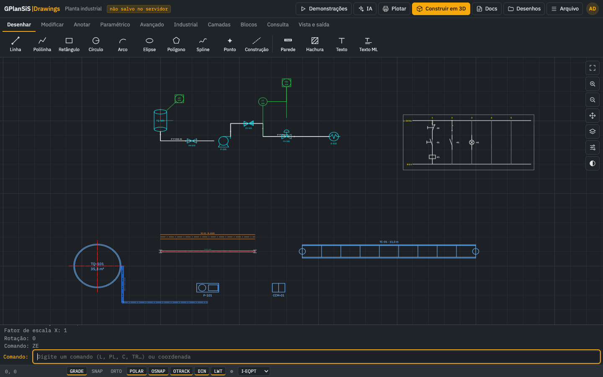
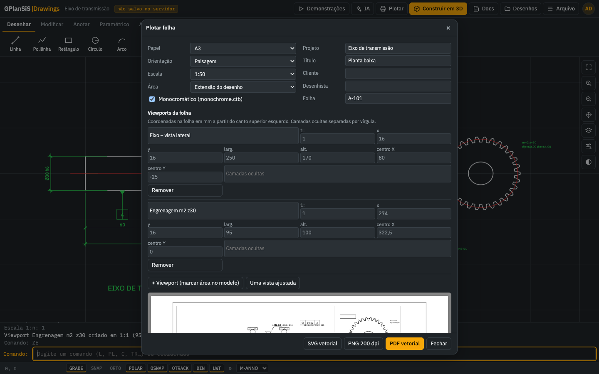
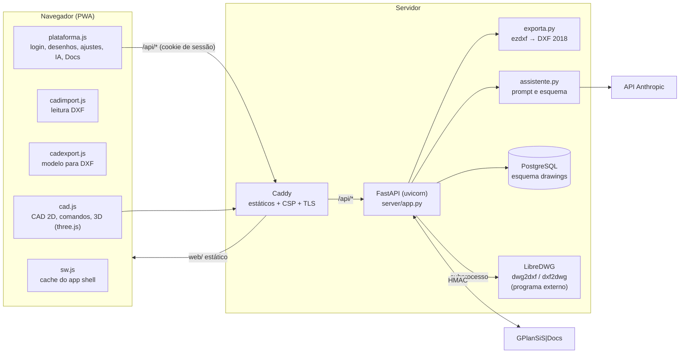

<p align="center">
  <a href="https://drawings.gplansis.com"></a>
</p>

<h1 align="center">GPlanSiS|Drawings</h1>

<p align="center">
  <b>CAD 2D estilo AutoCAD com construção em 3D — no navegador do computador, tablet ou celular.</b><br>
  Arquitetura, estruturas metálicas, mecânica, P&amp;ID e elétrica industrial, com login, biblioteca de desenhos e assistente de IA.
</p>

<p align="center">
  <a href="https://drawings.gplansis.com"></a>
  <a href="LICENSE"><">
  
  
  
  
  <a href="CONTRIBUTING.md"></a>
</p>

<p align="center">
  <a href="https://drawings.gplansis.com"><b>➜ Abrir o GPlanSiS|Drawings</b></a> ·
  <a href="#como-rodar-localmente">Rodar localmente</a> ·
  <a href="#contribua">Contribua</a> ·
  <a href="docs/guia.md">Guia detalhado</a>
</p>

---

## O que é

O **GPlanSiS|Drawings** é um CAD 2D com a linha de comando e os atalhos do AutoCAD (`L`, `PL`, `C`, `TR`, `O`, `F`, `M`, `CO`, `DLI`…) que roda inteiro no navegador e transforma a planta em modelo 3D com um clique. Ele nasceu para engenharia brasileira: unidade em milímetro, interface em português, símbolos de P&ID (ISA 5.1) e elétricos (IEC 60617), perfis de aço, tubulação, eletrocalha e listas industriais.

Existem duas formas de uso:

| Edição | Onde | Para quê |
|---|---|---|
| **Servidor** (`web/` + `server/`) | [drawings.gplansis.com](https://drawings.gplansis.com) | Login, desenhos guardados no servidor com versões, compartilhamento, permissões por usuário, DWG, DXF 2018, assistente IA e integração com o GPlanSiS\|Docs. |
| **Arquivo único** (`standalone/`) | Qualquer navegador, até sem internet | O mesmo CAD num único HTML: dois cliques e pronto. Os desenhos ficam no armazenamento do navegador. |

## Funcionalidades

**Desenho e edição** — linha, polilinha, retângulo, círculo, arco, elipse, polígono, spline, construção, parede, hachura com detecção de contorno, texto e texto multilinha; mover, copiar, girar, escala, espelhar, offset, aparar, estender, concordar, chanfro, matriz, esticar, explodir, unir, quebrar e alças (grips). Osnap, orto, polar, rastreamento e entrada dinâmica (F3, F8, F10, F11, F12). Coordenadas `x,y`, `@dx,dy` e `@dist<ângulo`.

**Anotação e consulta** — cotas linear, alinhada, raio, diâmetro, angular, contínua e de base; chamada; ambientes com área; distância, área e listagem.

**Paramétrico** — restrições horizontal, vertical, paralela, perpendicular, coincidente, fixa e igual; cotas paramétricas com expressões (`d2 = d1·0,6`); gerenciador de parâmetros.

**Avançado** — booleanas (união, subtração, interseção, XOR), blocos com atributos e extração CSV, GD&T e datums, tolerâncias de cota, imagem com vetorização, folhas com viewports e exportação IFC4.

**Industrial** — P&ID ISA 5.1, elétrico IEC 60617, parafusos ISO 4017, rolamentos 60/62/63, perfis IPE/HEA/W/UPN/L/RHS/CHS, engrenagens evolventes, solda e rugosidade, tubulação DN15–DN300, eletrocalha, tanques, esteiras e equipamentos em 3D; listas de equipamentos, instrumentos, linhas, fios, aço e materiais.

**3D** — "Construir em 3D" ergue paredes, aberturas, mobiliário, estruturas, tubulação e equipamentos com three.js (vistas isométrica, topo e frontal; exporta PNG).

**Arquivos CAD**
- **DWG**: leitura no servidor, convertido por [LibreDWG](https://www.gnu.org/software/libredwg/) (`dwg2dxf`); gravação em DWG 2000 em beta (`dxf2dwg`).
- **DXF**: leitura de qualquer versão ASCII no navegador (`web/cadimport.js`) — arcos de polilinha, splines/NURBS, elipses, hachuras, matrizes de blocos, atributos, cotas, acentos e `$INSUNITS`.
- **Exportação**: DXF AutoCAD 2018 (gerado no servidor com [ezdxf](https://ezdxf.mozman.at/)), DXF R12, SVG, PNG, JSON e IFC4.
- **Plotagem**: A4 a A0, escala ou ajuste, monocromático, carimbo e viewports; saída em SVG, PNG 200 dpi ou **PDF vetorial** (svg2pdf + jsPDF).

**Plataforma (edição servidor)**
- Papéis Administrador, Projetista, Revisor e Consulta, com ajuste permissão por permissão (desenhar, excluir, compartilhar, importar, exportar, plotar, IA, auditoria, usuários).
- Ctrl+S salva no servidor; 40 versões por desenho; aviso de conflito quando duas pessoas editam; lixeira de 30 dias; compartilhamento com a equipe ou por usuário (ver / editar).
- Perfil com foto, troca de senha, sessões ativas, preferências (tema, salvamento automático, reabrir o último desenho) e registro de acessos.
- **Assistente IA** com modos Desenhar, Revisar desenho e Extrair listas; usa o desenho (ou a seleção) e as listas do CAD como contexto, aceita croqui/foto/PDF e responde em streaming. A chave da Anthropic fica cifrada no servidor e nunca volta ao navegador.
- **Integração com o GPlanSiS|Docs**: entrada única assinada, envio de PDF + DXF + JSON como documento com revisão e retorno de situação e comentários como nuvens de revisão.
- **PWA**: instalável no computador, Android e iPhone; ajustes próprios para celular (alvos de toque, dois dedos para zoom e pan).

**Seis demonstrações** (botão ▶ Demonstrações): apartamento de 92 m², planta industrial, eixo de transmissão, chapa paramétrica, partida estrela-triângulo e galpão com pipe rack.

## Telas

<table>
  <tr>
    <td width="50%"><br><sub><b>Planta 2D</b> — eixos, paredes com isolamento, portas, mobiliário, cotas e áreas.</sub></td>
    <td width="50%"><br><sub><b>Construir em 3D</b> — a mesma planta erguida em three.js.</sub></td>
  </tr>
  <tr>
    <td width="50%"><br><sub><b>Industrial</b> — P&ID com malha de controle, esquema elétrico, tanque, tubulação, eletrocalha e esteira.</sub></td>
    <td width="50%"><br><sub><b>Plotagem</b> — folha A3 com viewports, carimbo e PDF vetorial.</sub></td>
  </tr>
</table>

<sub>Capturas feitas numa instância local com o usuário fictício <code>admin@exemplo.com</code> e as demonstrações embutidas.</sub>

## Arquitetura



- **Front** sem build: HTML, CSS e JavaScript puros, servidos como arquivos estáticos. Bibliotecas de terceiros ficam em `web/vendor/` e são servidas pelo próprio domínio (CSP `script-src 'self'`).
- **API** FastAPI com sessões em cookie HttpOnly, senhas em scrypt, proteção CSRF por cabeçalho próprio (`x-drawings: 1`), bloqueio por tentativas e auditoria.
- **Banco** PostgreSQL: `usuarios`, `sessoes`, `desenhos`, `desenho_acesso`, `desenho_versoes`, `acessos`, `config`, `docs_vinculo` e `sso_nonce` (`server/schema.sql`, aplicado automaticamente na partida).
- **DWG** pelo LibreDWG, chamado como programa externo em subprocesso (não é ligado ao código Python).

## Stack

| Camada | Tecnologias |
|---|---|
| Front | JavaScript sem framework, Canvas 2D, [three.js](https://threejs.org/) r128, [JSZip](https://stuk.github.io/jszip/) 3.10.1, [jsPDF](https://github.com/parallax/jsPDF) 4.2.1, [svg2pdf.js](https://github.com/yWorks/svg2pdf.js), [polygon-clipping](https://github.com/mfogel/polygon-clipping) 0.15.7, fontes IBM Plex |
| API | Python 3, [FastAPI](https://fastapi.tiangolo.com/), uvicorn, psycopg 3 + pool, cryptography (Fernet), [ezdxf](https://ezdxf.mozman.at/), httpx, SDK `anthropic` |
| Dados | PostgreSQL |
| Conversão DWG | [LibreDWG](https://www.gnu.org/software/libredwg/) 0.14 (`dwg2dxf`, `dxf2dwg`) — opcional |
| Produção | Caddy (TLS, CSP, estáticos), systemd |

## Como rodar localmente

### Só o CAD (sem servidor)

Abra `standalone/GPlanSiS-Drawings-offline.html` no Chrome, Edge, Safari ou Firefox. Ele traz three.js, JSZip, polygon-clipping e jsPDF embutidos e funciona sem internet. A versão `-online.html` é mais leve e baixa as bibliotecas por CDN quando precisa.

### Edição servidor

Requisitos: Python 3.11+, PostgreSQL 14+ e, opcionalmente, LibreDWG para DWG.

```bash
git clone https://github.com/SSBianchiplan/drawings.git
cd drawings

# 1. banco
createdb drawings                       # ou: psql -c "create database drawings"

# 2. ambiente Python
python3 -m venv .venv
.venv/bin/pip install -r server/requirements.txt

# 3. variáveis (valores fictícios; veja .env.example)
export DRAWINGS_DSN="postgresql://postgres@127.0.0.1:5432/drawings"
export DRAWINGS_MASTER=admin@exemplo.com
export DRAWINGS_COOKIE_SEGURO=0         # http:// local, sem HTTPS

# 4. administrador (imprime uma senha temporária; a troca é pedida no 1º acesso)
cd server
../.venv/bin/python app.py criar-admin admin@exemplo.com --nome "Administrador"

# 5. API + front num só processo (servidor de desenvolvimento)
../.venv/bin/uvicorn dev_local:app --port 8930 --reload
```

Abra <http://127.0.0.1:8930>, entre com o e-mail e a senha temporária e use **▶ Demonstrações** para ter um desenho na tela.

`server/dev_local.py` monta `web/` como estático sobre a mesma API. Em produção quem serve `web/` é o Caddy (`deploy/drawings.caddy`), com os cabeçalhos de segurança.

**Opcionais**
- **DWG**: compile o [LibreDWG](https://www.gnu.org/software/libredwg/) (`./configure --prefix=/opt/libredwg && make && make install`) ou aponte `DRAWINGS_DWG2DXF` / `DRAWINGS_DXF2DWG` para os binários. Sem eles, a importação de DWG fica desligada e o resto funciona.
- **Assistente IA**: entre como administrador e cole a chave da Anthropic em Configurações › Assistente IA (ou defina `ANTHROPIC_API_KEY`). Defina `DRAWINGS_SEGREDO` antes, para a chave ser guardada cifrada.

### Publicação

`deploy/publicar.sh` empacota `web/`, `server/` e `deploy/`, carimba a versão nos links de CSS/JS e no service worker, envia por SSH e roda `deploy/instalar.remoto.sh` no servidor (usuário de sistema, banco com autenticação peer, venv, `.env` inicial, unidade systemd, bloco Caddy validado antes do reload e verificação de saúde).

```bash
DRAWINGS_HOST=meu-servidor DRAWINGS_MASTER=admin@exemplo.com bash deploy/publicar.sh
```

## Estrutura de pastas

```
drawings/
├── web/                     front estático (servido pelo Caddy)
│   ├── index.html           casca da aplicação
│   ├── cad.js / cad.css     o CAD: comandos, desenho, cotas, industrial, 3D, plotagem
│   ├── cadimport.js         leitura de DXF (ASCII, qualquer versão)
│   ├── cadexport.js         modelo intermediário para exportação DXF
│   ├── plataforma.js/.css   login, biblioteca de desenhos, configurações, IA, Docs
│   ├── celular.css          ajustes para tela pequena
│   ├── sw.js, pwa.js, manifest.webmanifest, icones/   PWA
│   └── vendor/              three.js, JSZip, jsPDF, svg2pdf, polygon-clipping
├── server/
│   ├── app.py               API FastAPI (auth, usuários, desenhos, IA, DWG, Docs) + CLI criar-admin
│   ├── assistente.py        instruções e esquema de resposta do assistente IA
│   ├── exporta.py           escrita de DXF 2018/2000 com ezdxf
│   ├── schema.sql           esquema PostgreSQL (idempotente)
│   ├── dev_local.py         servidor de desenvolvimento (API + web/)
│   └── requirements.txt
├── standalone/              CAD em arquivo HTML único (offline e online)
├── deploy/                  publicar.sh, instalar.remoto.sh, unidade systemd, bloco Caddy
├── docs/guia.md             guia detalhado de uso e operação
└── .github/                 capa, telas, modelos de issue e PR
```

## Variáveis de ambiente

Todas lidas por `server/app.py`. Modelo com valores fictícios em [`.env.example`](.env.example).

| Variável | Para quê |
|---|---|
| `DRAWINGS_DSN` | Conexão PostgreSQL |
| `DRAWINGS_MASTER` | E-mail do administrador master |
| `DRAWINGS_SESSAO_HORAS` | Duração da sessão (padrão 12) |
| `DRAWINGS_COOKIE_SEGURO` | `1` (padrão) cookie Secure; `0` para http local |
| `DRAWINGS_SEGREDO` | Chave Fernet que cifra a chave da IA no banco |
| `ANTHROPIC_API_KEY` | Chave da IA de reserva (opcional) |
| `DRAWINGS_IA_MODELO` | Modelo padrão do assistente |
| `DRAWINGS_DWG2DXF`, `DRAWINGS_DXF2DWG` | Caminhos dos binários do LibreDWG |
| `DRAWINGS_CONV_SOCKET` | Socket do serviço de conversão isolado (`deploy/drawings-conv.*`); vazio = converte no próprio processo, com ambiente vazio, diretório temporário e limites |
| `DRAWINGS_CONV_TIMEOUT_S`, `DRAWINGS_CONV_CPU_S`, `DRAWINGS_CONV_MEM_MB`, `DRAWINGS_CONV_FSIZE_MB` | Prazo e limites de recurso de cada conversão (padrão 120 s, 110 s de CPU, 1536 MB, 400 MB) |
| `DRAWINGS_URL` | Endereço público do Drawings (links enviados ao Docs) |
| `DRAWINGS_DOCS_SEGREDO`, `DRAWINGS_DOCS_URL`, `DRAWINGS_DOCS_API` | Integração com o GPlanSiS\|Docs (opcional) |

## Contribua

O Drawings está no ar e tem muito espaço para crescer. **Toda ajuda é bem-vinda** — de quem desenha, de quem programa e de quem só quer apontar um problema.

**Onde dá para ajudar agora**
- **Formatos CAD** — DXF binário, MLEADER, imagens raster e sólidos/malhas na importação (hoje não lidos); estabilizar a gravação DWG (beta).
- **Paramétrico** — restrições em vértices de polilinha (hoje valem para linhas, paredes, círculos e arcos).
- **Industrial** — tubulação 3D com mudança de elevação no meio do trecho; novas bibliotecas de símbolos ISA/IEC; mais perfis e normas.
- **Plotagem** — mais formatos de carimbo e folhas personalizadas.
- **Celular e acessibilidade** — gestos, leitores de tela, contraste.
- **Testes** — hoje não há suíte automatizada: testes da API (pytest + PostgreSQL temporário) e de leitura de DXF com arquivos de exemplo são ótimas primeiras contribuições.
- **Documentação** — tutoriais, vídeos curtos, tradução da interface.

**Boas primeiras issues**
1. Testes de `server/exporta.py` gerando um DXF e relendo com ezdxf.
2. Testes da API de autenticação (`/api/auth/*`) e do controle de versão (`409` em conflito).
3. Arquivos DXF pequenos de exemplo (sem dados de cliente) para regressão do `cadimport.js`.
4. Um `docker-compose.yml` de desenvolvimento (PostgreSQL + API).

Leia o [guia de contribuição](CONTRIBUTING.md), abra uma [issue](../../issues/new/choose) contando o que pretende fazer e mande seu pull request. Siga o [código de conduta](CODE_OF_CONDUCT.md). Falhas de segurança: veja [SECURITY.md](SECURITY.md).

## Licença

Código próprio sob a **[licença MIT](LICENSE)** — Copyright (c) 2026 GPlanSiS.

Componentes de terceiros mantêm as próprias licenças:

| Componente | Licença | Como é usado |
|---|---|---|
| three.js, JSZip (opção MIT), jsPDF, svg2pdf.js, polygon-clipping | MIT | embutidos em `web/vendor/` e `standalone/` |
| FastAPI, ezdxf | MIT | dependências Python |
| uvicorn, httpx | BSD-3-Clause | dependências Python |
| cryptography | Apache-2.0 ou BSD-3-Clause | dependência Python |
| anthropic (SDK) | Apache-2.0 | dependência Python |
| psycopg 3 | LGPL-3.0 | dependência Python (instalada pelo pip, não modificada) |
| LibreDWG | GPL-3.0-or-later | **programa externo opcional**, chamado em subprocesso; não faz parte deste repositório |

## Créditos

Feito pela **[GPlanSiS](https://drawings.gplansis.com)**. Contato: [contato@gplansis.com](mailto:contato@gplansis.com).

Agradecimentos aos projetos LibreDWG, ezdxf, three.js, jsPDF, svg2pdf.js, JSZip e polygon-clipping, sem os quais este CAD não existiria.
